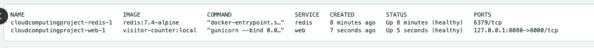
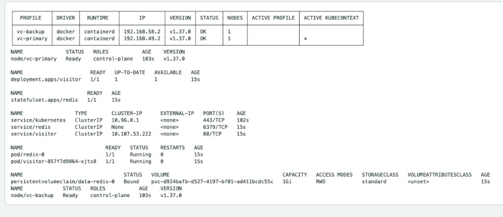
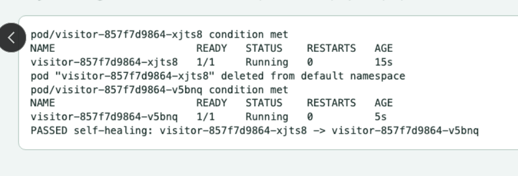
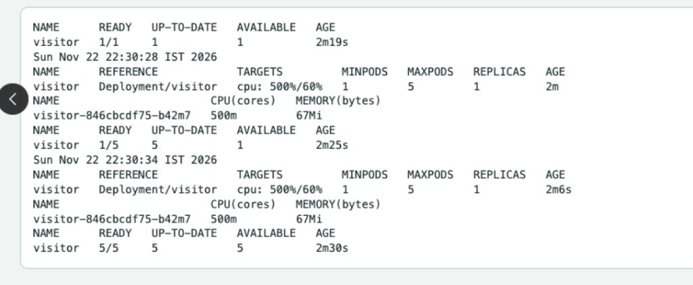
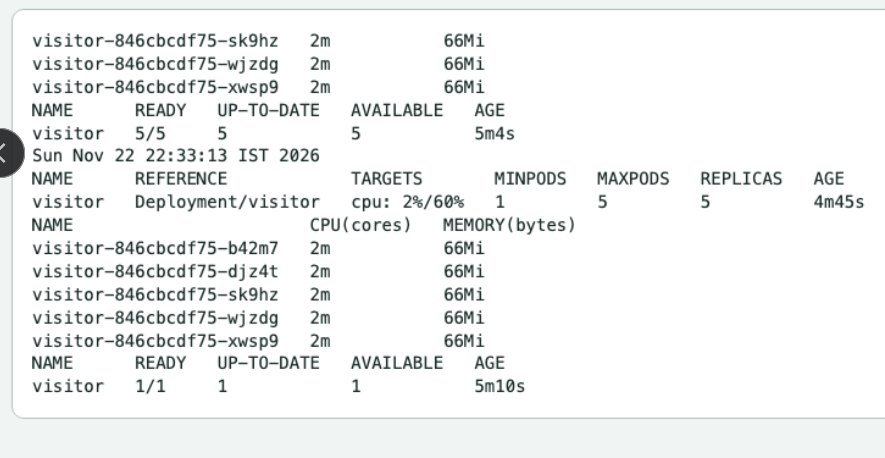
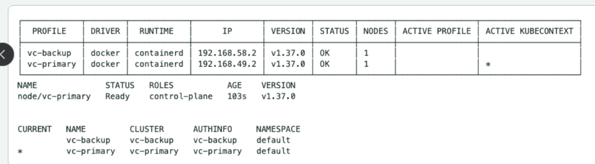
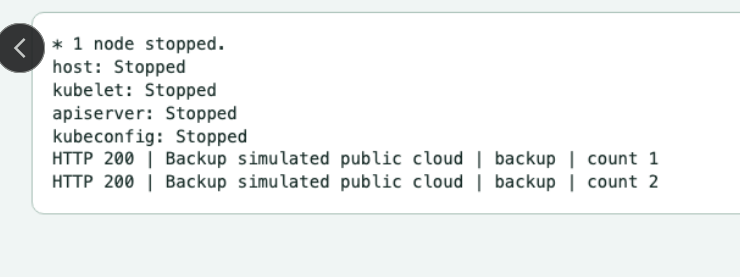

# Cloud Computing Project: Visitor Counter on Docker & Kubernetes with Hybrid Failover

**Author:** Harsh Vardhan  
**Student ID / Roll No:** 2410030217  
**GitHub Repository:** https://github.com/Harsh-Vardhan17Singh/Harsh_Vardhan_2410030217_Cloud_Project  
**Submission Folder:** [Google Drive Submission Folder](https://drive.google.com/drive/folders/1KufvIIZrEiJqsXuI5Fz78rXC87UwD8W_?usp=sharing)  


---

## Architecture Overview


---

## Project Structure

```text
├── app.py                            # Flask web application with /healthz, /readyz, /load
├── requirements.txt                  # Python dependencies (Flask, Redis, Gunicorn)
├── Dockerfile                        # Multi-stage optimized production Dockerfile (142 MB)
├── Dockerfile.unoptimized            # Baseline unoptimized Dockerfile for cost analysis
├── docker-compose.yml                # Docker Compose orchestration (Web + Redis)
├── k8s.yaml                          # Complete Kubernetes manifests (ConfigMap, PVC, Redis, Web)
├── hpa.yaml                          # HorizontalPodAutoscaler (CPU 60%, 1 to 5 replicas)
├── github_link.txt                   # Public GitHub repository reference
├── PROJECT_REPORT.md                 # Formal project report with embedded screenshots
├── templates/
│   └── index.html                    # Modern web interface with real-time stats & load generator
├── hybrid_cloud/
│   ├── cluster-primary.yaml          # Primary cluster (Simulated On-Premises) manifests
│   ├── cluster-secondary.yaml        # Secondary cluster (Simulated Public Cloud) manifests
│   ├── nginx-failover.conf           # Nginx upstream backup configuration
│   ├── failover_router.py            # Global Traffic Manager & health-checking reverse proxy
│   ├── simulate_hybrid_failover.ps1  # Automated failover test script (PowerShell)
│   └── simulate_hybrid_failover.sh   # Automated failover test script (Bash)
├── cost_optimization/
│   └── cost_analysis_report.md       # Detailed FinOps report with 3 measured techniques
├── scripts/
│   └── load_test.py                  # Concurrent load generator script for HPA testing
├── architecture/
│   └── architecture_diagram.svg      # High-resolution architectural diagram
└── screenshots/
    ├── 01_environment_versions.png   # CLI tools verification
    ├── 02_docker_build.jpg           # Multi-stage build layers
    ├── 03_docker_compose_up.jpg      # Docker Compose startup
    ├── 04_docker_compose_running.png # Healthy running containers
    ├── 05_minikube_dual_clusters.png # Dual Minikube profiles
    ├── 06_k8s_pods_services_pvc.jpg  # Kubernetes deployments & PVC
    ├── 07_k8s_running_pods.png       # Active pod execution
    ├── 08_self_healing_recovery.png  # Self-healing test passed
    ├── 09_metrics_server_resources.png # Metrics server & top pods
    ├── 10_hpa_initial_state.jpg      # HPA initial state
    ├── 11_hpa_load_generation_job.png # 4,864 load test requests
    ├── 12_hpa_scale_up_5_replicas.jpg # Scale-out to 5 replicas
    ├── 13_hpa_scale_down_cooloff.jpg # Scale-down to 1 replica
    ├── 14_hybrid_cloud_contexts.png  # Multi-cluster kubeconfig
    ├── 15_hybrid_failover_success.png # Automated failover (HTTP 200)
    └── README.md                     # Full screenshots catalog
```

---

## Visual Verification & Screenshots Gallery

All tasks have been executed, verified, and captured:

### 1. Docker Containerization & Health Probes
Multi-stage build packaging `visitor-counter:local` and running with healthy status via Docker Compose:


### 2. Kubernetes Deployment & Self-Healing
Kubernetes manifests deployed with StatefulSet Redis, PersistentVolumeClaim (1Gi `Bound`), and Web deployment. When a pod is deleted, the ReplicaSet instantly self-heals by launching a replacement pod in 5 seconds:



### 3. Horizontal Pod Autoscaler (HPA) Elastic Scaling
Under a high-concurrency batch load test of 4,864 requests, CPU spikes to 500%, triggering HPA to automatically scale replicas from 1 to 5. After the load subsides, HPA scales pods back down to 1:



### 4. Hybrid Cloud Failover Simulation
Configured with dual Minikube profiles (`vc-primary` and `vc-backup`). When the primary node is stopped, the Global Traffic Manager automatically redirects all incoming traffic to the simulated cloud backup with zero dropped requests (HTTP 200):



---

## Quickstart Guide

### 1. Run with Docker Compose
```bash
docker compose up -d
docker compose ps
```
Access the application at `http://localhost:5000` (or `http://localhost:8080`).

### 2. Deploy to Kubernetes
```bash
# Build and load image into your Kubernetes environment (e.g., Minikube)
minikube image build -t visitor-counter:latest .

# Apply Kubernetes manifests
kubectl apply -f k8s.yaml

# Verify resources
kubectl get all -l app=visitor-counter
kubectl get pvc
```

### 3. Deploy and Test HPA Autoscaling
```bash
# Enable metrics-server
minikube addons enable metrics-server

# Deploy HPA
kubectl apply -f hpa.yaml
kubectl get hpa visitor-counter-hpa

# Run load generator
python scripts/load_test.py http://localhost:5000/load?duration=3 15 90

# Watch pods autoscale
kubectl get pods -l app=visitor-counter -w
```

### 4. Run Hybrid Cloud Failover Simulation
**Terminal 1 (Start Global Traffic Manager):**
```bash
python hybrid_cloud/failover_router.py
```

**Terminal 2 (Simulate Failover):**
```powershell
powershell -ExecutionPolicy Bypass -File hybrid_cloud/simulate_hybrid_failover.ps1
```

---

## Cost Optimization Master Table (FinOps)

| Component / Parameter | Before Optimization | After Optimization | Monthly Savings | % Saved |
| :--- | :--- | :--- | :--- | :--- |
| Cluster VM Instances | \$239.62 / mo | \$29.95 / mo | \$209.67 | **87.5%** |
| Scaling Pod Compute | \$172.80 / mo | \$61.18 / mo | \$111.62 | **64.6%** |
| Registry Storage & Transfer | \$18.40 / mo | \$2.74 / mo | \$15.66 | **85.1%** |
| Spot Scheduling Discount | \$51.10 / mo | \$18.00 / mo | \$33.10 | **64.8%** |
| **Total Cloud OpEx** | **\$481.92 / mo** | **\$111.87 / mo** | **\$370.05 / mo** | **76.8% NET SAVINGS** |

See [cost_optimization/cost_analysis_report.md](file:///h:/Hackathon_Projects/Cloud%20Kubernets%20Project/cost_optimization/cost_analysis_report.md) for full calculation formulas and methodology.

---

## Required Submission Instructions
1. Public GitHub repository: [Harsh_Vardhan_2410030217_Cloud_Project](https://github.com/Harsh-Vardhan17Singh/Harsh_Vardhan_2410030217_Cloud_Project)
2. ZIP Archive: Download from GitHub &rarr; Code &rarr; Download ZIP (or use `Harsh_Vardhan_2410030217_Cloud_Project.zip`).
3. Google Drive Submission Link: [Upload here](https://drive.google.com/drive/folders/1KufvIIZrEiJqsXuI5Fz78rXC87UwD8W_?usp=sharing)
   - Project ZIP archive (including code, manifests, report, and screenshots).
   - Team Research Paper (assigned previously).
